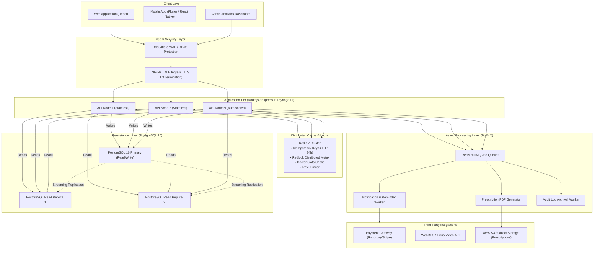
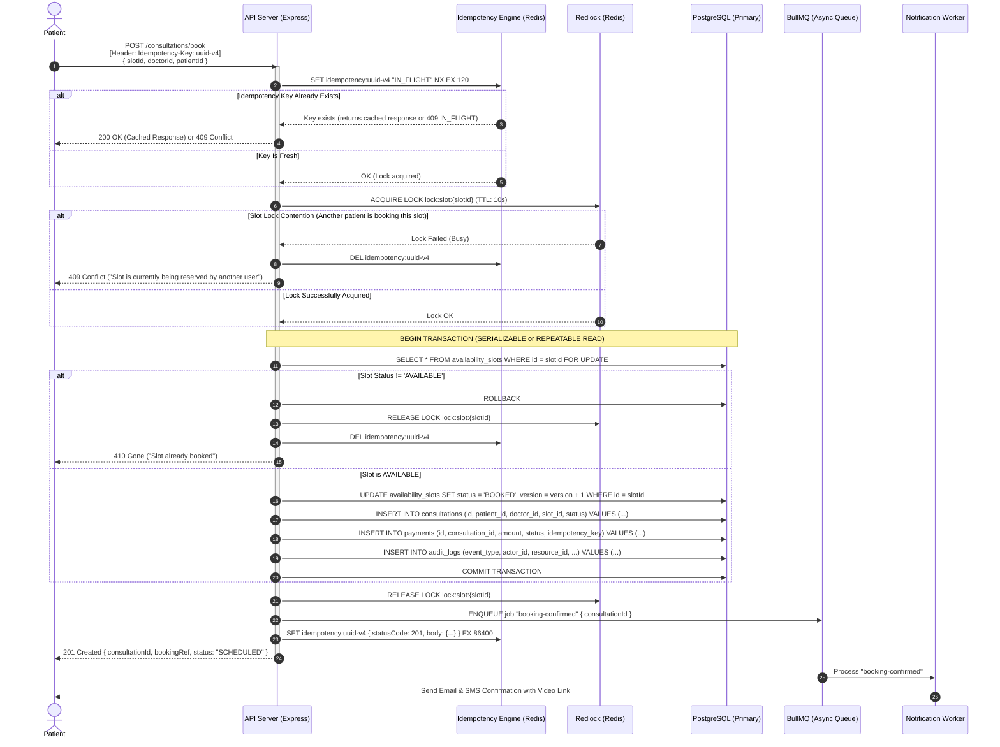
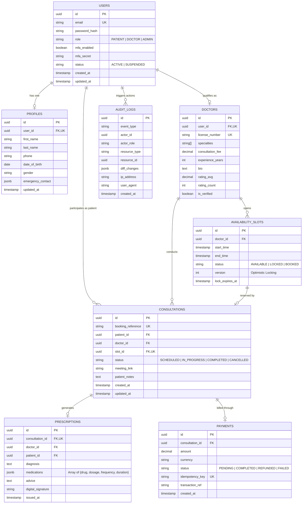

# Amrutam Telemedicine System — Architecture & System Design Specification

**Document Version**: 1.0.0  
**Target Scale**: 100,000 Daily Consultations (~1.15 writes/sec sustained, ~40 writes/sec peak, ~400 reads/sec peak)  
**System SLA**: 99.95% Availability (~4.38 hours downtime/year max)  
**Performance Targets**: p95 Reads < 200ms | p95 Writes < 500ms  
**Compliance Standards**: HIPAA-aligned PHI Protection, Zero-Trust Architecture, OWASP Top 10 Mitigation  

---

## 1. Executive Summary & Capacity Estimation

Amrutam’s telemedicine platform provides digital ayurvedic consultations, connecting patients with certified practitioners. To reliably serve **100,000 daily consultations**, the backend architecture is built with high concurrency, strict write idempotency, sub-second latency, and data integrity at its core.

### Traffic & Storage Projections
* **Daily Consultations**: 100,000 consultations/day
* **Read-to-Write Ratio**: ~10:1 (Browsing doctors, checking availability slots, reading profiles vs. booking/paying)
* **Write Throughput**: 100,000 / 86,400s ≈ **1.16 writes/sec average**, with peak busy hours (4x multiplier) ≈ **40–50 writes/sec**.
* **Read Throughput**: 1,000,000 / 86,400s ≈ **11.6 reads/sec average**, with peak busy hours ≈ **400–500 reads/sec**.
* **Database Growth**:
  * Consultation record + prescription + audit log ≈ ~5 KB per consultation.
  * $100,000 \times 5\text{ KB} = 500\text{ MB/day} \approx 182.5\text{ GB/year}$.
  * Easily managed with PostgreSQL declarative range partitioning and read replicas.

---

## 2. High-Level Architecture & Data Flow (Task 1)

The system adopts a **Modular Monolith with Dependency Injection** architecture, optimized for operational simplicity, low latency, and eventual microservice extraction.



### Data Flow Lifecycle
1. **Request Ingestion**: Requests pass through Cloudflare WAF (DDoS protection, rate limiting) to the Ingress Load Balancer.
2. **Gateway Processing**: The Express API layer terminates the request, runs Helmet headers, validates CORS, assigns a UUID `X-Request-ID`, and records Prometheus metrics.
3. **Idempotency Gate**: Write requests (`POST /consultations/book`) require an `Idempotency-Key` header. Redis is queried atomically. If the key exists, the cached result is returned immediately.
4. **Distributed Concurrency Lock**: A Redis Redlock mutex is acquired on `slot:${slotId}` to ensure only one user can book a slot at a time.
5. **Persistence**: Transactions are executed on PostgreSQL Primary using ACID isolation.
6. **Async Offloading**: Non-blocking tasks (PDF rendering, WhatsApp/SMS reminders, audit flushing) are enqueued into BullMQ for background worker processing.

---

## 3. High-Concurrency Booking Flow Sequence Diagram (Task 2)

Booking a doctor’s consultation must be completely immune to race conditions (two patients clicking "Book" simultaneously on the same slot) and network retries (patient double-clicking).



---

## 4. Entity-Relationship (ER) Diagram (Task 3)

The data model captures all 8 core entities specified in the assessment with strict relational constraints, Foreign Keys, UUID primary keys, and specialized indexing.



### Critical Database Indexes
* `availability_slots(doctor_id, start_time, status)` — Compound index for sub-5ms slot lookups.
* `consultations(patient_id, status)` & `consultations(doctor_id, status)` — Fast user consultation histories.
* `doctors USING GIN (specialties)` — GIN inverted index for searching doctors by multiple Ayurvedic specialties.
* `audit_logs(created_at, resource_type, resource_id)` — Rapid audit trail reconstruction for compliance.

---

## 5. API Schema & REST Guidelines (Task 4)

The API strictly follows REST principles with resource-oriented URIs, standardized HTTP status codes, and RFC 7807 Problem Details error formats.

### Standard Response Envelope
```json
{
  "success": true,
  "data": { ... },
  "meta": {
    "page": 1,
    "limit": 20,
    "total": 142
  },
  "requestId": "4fa85f64-5717-4562-b3fc-2c963f66afa6",
  "timestamp": "2026-10-30T12:00:00.000Z"
}
```

### RFC 7807 Problem Details Error Envelope
```json
{
  "type": "https://api.amrutam.co.in/errors/slot-already-booked",
  "title": "Conflict",
  "status": 409,
  "detail": "The requested availability slot has already been reserved by another patient.",
  "instance": "/api/v1/consultations/book",
  "requestId": "4fa85f64-5717-4562-b3fc-2c963f66afa6",
  "timestamp": "2026-10-30T12:00:00.000Z"
}
```

---

## 6. Retry & Backoff Strategies (Task 5)

Network partitions, database connection pool exhaustion, and third-party payment gateway outages require robust retry mechanisms.

### Exponential Backoff with Full Jitter
To prevent the **Thundering Herd** problem where multiple failed retries fire at the identical second:

$$\text{Sleep Time} = \text{random}(0, \min(T_{\max}, T_{\text{base}} \times 2^{\text{attempt}}))$$

* $T_{\text{base}} = 100\text{ ms}$
* $T_{\max} = 5,000\text{ ms}$
* $\text{Max Attempts} = 3$ (API calls) or $5$ (Async background workers)

### Circuit Breaker Pattern
External integrations (Payment Gateway, WebRTC Video API, SMS gateway) are wrapped in a Circuit Breaker:
* **Closed**: Normal operations.
* **Open**: If failure rate exceeds 50% over a 30-second rolling window, requests fail fast immediately without hitting the degraded third-party service.
* **Half-Open**: After a 15-second cooldown, probe traffic is allowed through to test recovery.

---

## 7. Data Partitioning & Sharding Strategy (Task 6)

At 100,000 consultations per day, `consultations` and `audit_logs` generate millions of rows annually. Without partitioning, B-tree indexes exceed RAM cache limits, degrading p95 latency.

### 1. Range Partitioning by Time (PostgreSQL Native)
`consultations` and `audit_logs` are partitioned by month on `created_at`:
```sql
CREATE TABLE consultations (
    id UUID NOT NULL,
    created_at TIMESTAMP WITH TIME ZONE NOT NULL,
    ...
) PARTITION BY RANGE (created_at);

CREATE TABLE consultations_2026_10 PARTITION OF consultations
    FOR VALUES FROM ('2026-10-01 00:00:00+00') TO ('2026-11-01 00:00:00+00');
```
* **Benefit**: Queries filtering for current month consultations perform **partition pruning**, scanning only the active partition.
* **Cold Storage**: Historical partitions (>12 months) are detached, archived to parquet in S3, and queried via Athena/DuckDB for analytics.

### 2. Read/Write Connection Splitting
* **Primary DB**: Serves write operations (`INSERT`, `UPDATE`, `DELETE`) and critical reads inside transactions (`SELECT FOR UPDATE`).
* **Read Replicas (x2)**: Serves doctor search queries, analytics queries, and profile fetches.

---

## 8. Caching & Concurrency Handling (Task 7)

### Caching Architecture (Redis 7)
* **Doctor Profiles & Specialties**: Cached with a 1-hour TTL. Invalidated upon doctor profile update (`cache:doctor:{id}`).
* **Available Slots**: Cached with a 60-second TTL (`cache:slots:doctor:{id}:{date}`). Invalidated immediately upon slot reservation or cancellation.
* **Cache-Aside Pattern**: Read from cache ➔ on miss, read from Read Replica ➔ populate cache.

### Concurrency Handling: Distributed Redlock vs. Optimistic Locking
To prevent double bookings under high load:
1. **Tier 1 — Fast Distributed Mutex (Redis Redlock)**:
   * Key: `lock:slot:{slotId}`
   * TTL: 10,000ms with auto-release
   * Prevents simultaneous request execution at the web application tier.
2. **Tier 2 — Database Atomic Condition (Optimistic Locking & Conditional Update)**:
   ```sql
   UPDATE availability_slots 
   SET status = 'BOOKED', version = version + 1 
   WHERE id = :slotId AND status = 'AVAILABLE';
   ```
   * If `rows_affected == 0`, the transaction aborts and returns HTTP 409 Conflict. This provides defense-in-depth even if Redis were to temporarily fail.

---

## 9. Transaction Management & Sagas (Task 8)

Booking a consultation involves multiple distinct sub-operations:
1. Slot State Transition (`AVAILABLE` ➔ `BOOKED`)
2. Payment Authorization / Capture
3. Consultation Entity Creation
4. Doctor Notification Dispatch

### Orchestrated Saga Pattern with Compensating Transactions
When distributed systems or asynchronous payment gateways are involved, a Saga Orchestrator manages forward progress and compensating rollbacks:

| Step | Action | Compensating Action (On Failure) |
| :--- | :--- | :--- |
| **1. Reserve Slot** | Mark slot `LOCKED` with 10-minute hold | Revert slot to `AVAILABLE` |
| **2. Process Payment** | Charge patient via Payment Gateway | Trigger automatic refund to patient card |
| **3. Confirm Booking** | Set consultation status `SCHEDULED` | Mark consultation `CANCELLED_DUE_TO_FAILURE` |
| **4. Notify Doctor** | Enqueue reminder email/SMS | Enqueue cancellation notification |

If Step 2 or 3 fails, the orchestrator executes the compensating actions in reverse order, ensuring the system returns to a consistent state without orphan locked slots.

---

## 10. Backup & Disaster Recovery (DR) Strategy (Task 9)

### Service Level Objectives
* **Recovery Point Objective (RPO)**: **< 5 minutes** (Maximum tolerable data loss)
* **Recovery Time Objective (RTO)**: **< 30 minutes** (Maximum time to restore service)

### Strategy & Implementation
1. **Continuous WAL Archiving**:
   * PostgreSQL Write-Ahead Logs (WAL) are streamed continuously to Amazon S3 / Google Cloud Storage every 60 seconds using `pgBackRest` or `wal-g`.
   * Enables **Point-In-Time Recovery (PITR)** to any second in the preceding 30 days.
2. **Automated Daily Full Backups**:
   * Full database snapshots taken daily at 02:00 UTC during lowest traffic.
   * Backups encrypted at rest with AES-256 (KMS-managed keys).
3. **Multi-AZ High Availability**:
   * Primary database runs in Availability Zone A.
   * Synchronous standby replica runs in Availability Zone B.
   * Automatic failover via Patroni / AWS RDS Multi-AZ within 60 seconds if Zone A experiences power or network failure.
4. **Periodic DR Drills**:
   * Automated monthly test restoring the latest backup snapshot to an isolated staging environment, running integrity validation scripts to verify data restoration.

